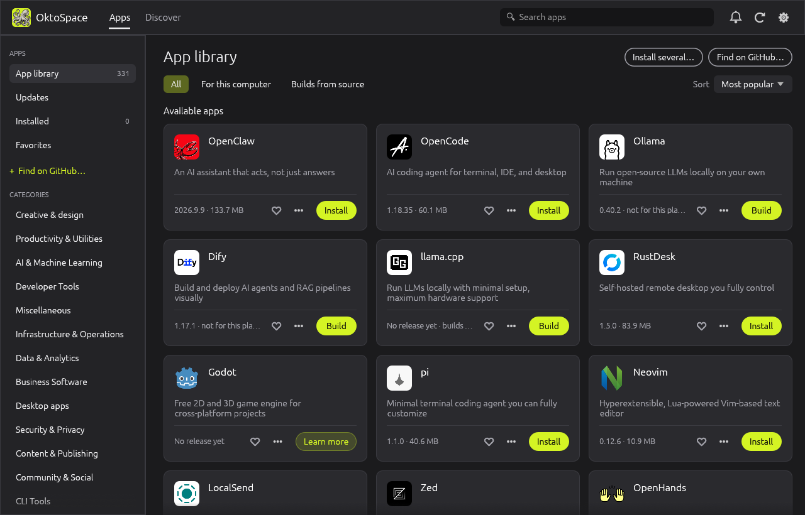
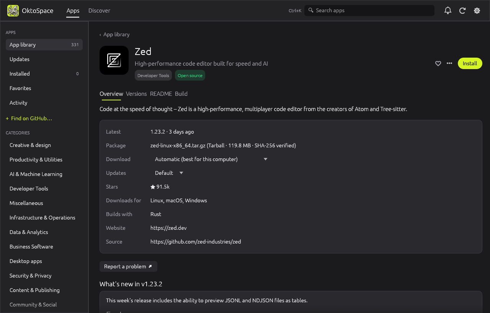
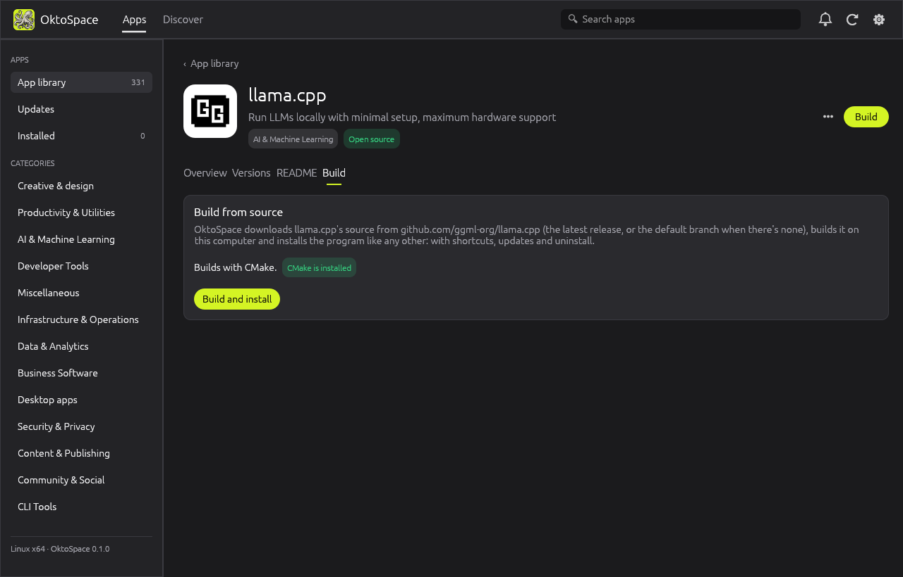
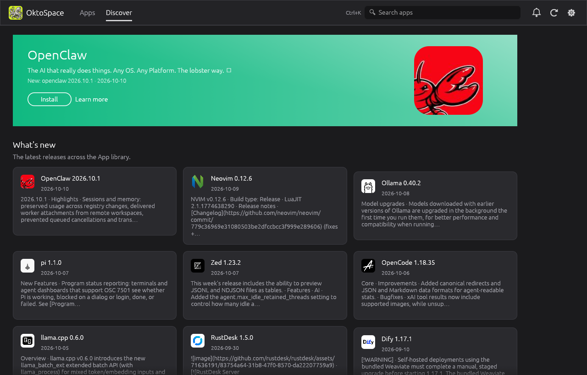

# OktoSpace

An app store, updater and builder for apps on GitHub. Pick an app from the **App library** (over
300 open-source apps) or add any repository: OktoSpace installs it from its releases, or **builds
it from source**, and keeps it up to date. Written in Rust, for Windows, macOS and Linux.



## What it does

**App library**
- Over 300 open-source apps by category (AI, developer tools, productivity, creative,
  infrastructure, games and more), sorted by popularity, with their stars, licence and the
  platforms they publish for. Search by name, description or repository.
- **Add any GitHub repository** (`owner/repo`): it joins the library and is installed and updated
  the same way.
- Every app page has an Overview with the screenshots from its README, every version (install or
  switch to any of them), release notes, the README itself, and a **Build** tab.

**Install from releases**
- OktoSpace picks the right download for your computer from a release's files: portable zips,
  tarballs, AppImages, disk images, MSIs, setup programs, `.deb` and `.rpm`, matched by the
  operating system and architecture in their names.
- Installs are per user and need no admin rights. Versions install side by side, so an update
  never leaves a half-written app behind and the previous version is kept for rollback.
- Every download is checked against the SHA-256 GitHub (or the release's checksum file)
  publishes before anything is unpacked.

**Build from source**
- For apps with nothing to download for your computer, or when you'd rather build it yourself:
  OktoSpace downloads the source of the latest release (or of the default branch when there's no
  release), recognises its build system, checks that the tools it needs are installed, and builds
  it with the output streamed live.
- The program it builds is installed like a download: menu entry, updates, rollback, uninstall.

| Found in the source | Builds with | Needs |
|---|---|---|
| `Cargo.toml` | `cargo build --release` | [Rust](https://rustup.rs) |
| `go.mod` | `go build` (each `cmd/*`, or the module) | [Go](https://go.dev/dl/) |
| `build.zig` | `zig build -Doptimize=ReleaseSafe` | [Zig](https://ziglang.org/download/) |
| `CMakeLists.txt` | `cmake` configure + build, Release | [CMake](https://cmake.org/download/) and a compiler |
| `meson.build` | `meson setup` + `meson compile` | [Meson](https://mesonbuild.com) and Ninja |
| `Package.swift` | `swift build -c release` | [Swift](https://www.swift.org/install/) |
| `*.sln`, `*.csproj` | `dotnet publish -c Release` | [.NET SDK](https://dotnet.microsoft.com/download) |
| `package.json` | `npm ci`, then its `tauri build`, `dist`, `package`, `make` or `build` script | [Node.js](https://nodejs.org) |
| `Makefile` | `make` | Make and a compiler |

**Updates**
- Checks GitHub on start and every few hours, from the tray / menu bar even when the window is
  closed, and shows a notification when updates are found. It can install them automatically.
- **Update channels per app**: stable releases, pre-releases too, or stay on a version.
- If an app is open, OktoSpace asks whether to update now (the new version is used next time) or
  **when it closes**, and waits for it.
- **Delta updates** for AppImages that publish a `.zsync`: only the changed blocks download.
- **Verify and repair**: checks every installed file and reinstalls if anything changed.
- A big library is checked sensibly: installed apps on every check, the rest when you open them,
  so GitHub's rate limits aren't a problem (add a token in Settings for more).

**For IT and classrooms**: a machine-wide policy file, a quiet command line, `install --all`,
app-list export/import and a shared package cache (see [below](#managing-many-computers)).

| App page | Build from source |
|---|---|
|  |  |
| **Discover** | |
|  | |

## Install OktoSpace

**Windows:** download `oktospace-<version>-windows-x64-setup.exe` (or `-arm64`) from
[Releases](https://github.com/emircesur/OktoSpace/releases) and run it: it installs for you
only, without administrator rights. For a copy that runs from any folder, take the
`-portable.zip`; it offers to install itself the first time.

**macOS:** download `oktospace-<version>-macos-universal.dmg`, open it and drag OktoSpace to
Applications. Until the releases are notarized, right-click it the first time and choose **Open**.

**Fedora, RHEL, openSUSE:** `sudo dnf install ./oktospace-<version>-linux-x86_64.rpm` (or `aarch64`).

**Debian, Ubuntu:** `sudo apt install ./oktospace-<version>-linux-x86_64.deb`.

**Any Linux (AppImage):**

```sh
chmod +x oktospace-*-linux-x86_64.AppImage && ./oktospace-*-linux-x86_64.AppImage
./oktospace-*-linux-x86_64.AppImage --cli list      # the command line, from the same file
```

**Any Linux (script):**

```sh
curl -fsSL https://raw.githubusercontent.com/emircesur/OktoSpace/HEAD/install.sh | sh
```

OktoSpace updates itself; installed from an `.rpm` or `.deb`, it leaves that to the package manager.

## Command line

```text
oktospace-cli list                       # every app, installed version, latest version
oktospace-cli info zed
oktospace-cli install zed localsend
oktospace-cli install zed --version 0.200.0
oktospace-cli build llama-cpp            # build from source and install
oktospace-cli build owner/repo           # any GitHub repository
oktospace-cli update                     # update everything (or name apps)
oktospace-cli check                      # exit code 10 when updates are available
oktospace-cli rollback zed
oktospace-cli verify zed | repair zed
oktospace-cli channel zed pin            # stay on this version (or stable / prerelease / default)
oktospace-cli launch zed
oktospace-cli uninstall zed
oktospace-cli source add owner/repo [--binary name] | list | check owner/repo | remove ID
oktospace-cli source set zed someone/zed-fork   # update an app from a fork (`official` to go back)
oktospace-cli export apps.json && oktospace-cli import apps.json [--exact]
oktospace-cli detect                     # find apps installed without OktoSpace and adopt them
oktospace-cli report-bug zed
oktospace-cli autostart on|off
oktospace-cli config [key] [value]       # e.g. config download_limit_kbps 2048
oktospace-cli self-update | self-install | paths | cleanup
```

For IT and classrooms:

```text
oktospace-cli apply-policy               # install required apps, move apps to pinned versions
oktospace-cli policy show [--json] | check policy.json | refresh
oktospace-cli update --scheduled         # for a scheduled task: only inside the update window
oktospace-cli report [--json] [--out FILE] [--to-share]
oktospace-cli cache fill [apps…] [--dir DIR] [--all-platforms] | status
```

`--quiet` prints nothing but errors and runs installers without any windows. `--refresh` skips
the 10-minute release cache. `-v` shows what is happening. Set `GITHUB_TOKEN` (or add a token in
Settings) to raise GitHub's rate limit. `OKTOSPACE_HOME` puts all of OktoSpace's state under
one folder.

## Where apps go

| | Windows | macOS | Linux |
|---|---|---|---|
| Apps | `%LOCALAPPDATA%\OktoSpace\Apps\<app>\<version>` | current version in `~/Applications`, older ones in `~/Library/Application Support/OktoSpace` | `~/.local/share/oktospace/apps/<app>/<version>` |
| Menu entry | Start menu › OktoSpace › *App* | Launchpad / Spotlight | `.desktop` file |
| Command line | | | `~/.local/bin/<app>` |
| Uninstall entry | Settings › Apps | | |

On Fedora and Debian-based systems, Settings › **Install apps as system packages** installs an
app's `.rpm` or `.deb` through the package manager instead, when its release has one. Setup
programs and MSIs run silently; OktoSpace then finds the program and its uninstaller.

## Managing many computers

Deploy a `policy.json` to `%ProgramData%\OktoSpace\` (Windows),
`/Library/Application Support/OktoSpace/` (macOS) or `/etc/oktospace/` (Linux):

```json
{
  "organization": "Riverside School Lab",
  "support": "https://help.example.edu/lab",
  "settings": { "auto_install_updates": true, "include_prereleases": false },
  "lock_settings": false,
  "required_apps": ["zed", "localsend"],
  "allowed_apps": ["zed", "localsend", "obs-studio"],
  "blocked_apps": [],
  "pinned_versions": { "zed": "0.200.0" },
  "update_window": { "days": ["mon", "tue", "wed", "thu", "fri"], "from": "17:00", "to": "07:00" },
  "prevent_uninstall": true,
  "report_dir": "\\\\server\\oktospace\\reports",
  "policy_url": "https://example.edu/oktospace/policy.json",
  "disable_self_update": false,
  "quiet": true
}
```

- `settings` values are forced and shown as locked in the app; `lock_settings` locks all of them.
- `required_apps` are installed on start (or with `oktospace-cli apply-policy`); `allowed_apps`
  hides everything else and `blocked_apps` hides single apps.
- `pinned_versions` keeps every computer on the same version.
- `update_window` limits automatic updates to those hours; manual updates are always allowed.
- `prevent_uninstall` hides Uninstall, Rollback and channel choices.
- `report_dir` gets a `<computer name>.json` after each check with every app's version and state.
- `policy_url` is fetched on each check and replaces this file's values, so a whole room changes
  from one place.

Computers can share a **package cache**: set a folder (Settings › IT & Classroom, or
`oktospace-cli config package_cache '\\server\oktospace\packages'`), fill it with
`oktospace-cli cache fill`, and every computer installs from it after checking the checksum.

## Building OktoSpace

```sh
cargo run -p oktospace          # the app
cargo run -p oktospace-cli -- list
cargo test --workspace
```

- `crates/oktospace-core`: the library, GitHub release discovery, downloads (resume, speed
  limit, zsync deltas), building from source, unpacking, desktop integration, policy and updates.
  No UI.
- `crates/oktospace`: the desktop app ([egui](https://github.com/emilk/egui)).
- `crates/oktospace-cli`: the command line.

CI runs the tests and clippy on Windows, macOS and Linux, real installs, updates, rollbacks and
uninstalls on each, a real build from source on Linux, a GUI smoke test on each desktop, and an
RPM build in a Fedora container. Pushing a `v*` tag (or running the Release workflow with a tag)
builds and publishes Windows, macOS and Linux packages with a `SHA256SUMS.txt`.

### The App library

`catalog.json` is the library. Most of it is rebuilt by the **App library** workflow
(`tools/library.py`), which reads curated lists of open-source apps and keeps the ones that have
something to install or can be built: each app's repository, stars, licence, the platforms its
latest release publishes for, and its build system. Entries marked `"curated": true` are picked
by hand and kept when the library is rebuilt. To add an app by hand, add a curated entry with
its repository, name, two-letter badge, colors and category, and bump `revision`.

## License

MIT or Apache-2.0, at your option. OktoSpace isn't affiliated with GitHub or with the apps'
developers. App names and icons belong to their owners; OktoSpace downloads icons from GitHub
instead of bundling them.
